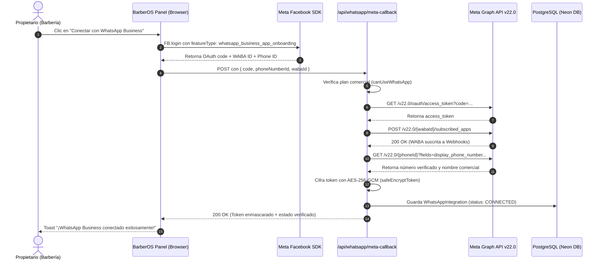

# BARBEROS — GUÍA OFICIAL DE INTEGRACIÓN META WHATSAPP BUSINESS PLATFORM (EMBEDDED SIGNUP V4 & COEXISTENCIA)

Esta guía documenta la arquitectura técnica, configuración paso a paso, políticas de seguridad y procedimientos para operar **WhatsApp Business Platform** en BarberOS utilizando **Meta Embedded Signup v4** con modo oficial de **Coexistencia**.

---

## 1. RESUMEN EJECUTIVO Y ESTADO DE LA IMPLEMENTACIÓN

BarberOS cuenta con una integración oficial directa contra la **Meta Cloud API (Graph API v22.0)**. Se han resuelto todos los puntos críticos auditados:

1. **Parámetro Oficial de Coexistencia v4:** Se inyecta `featureType: 'whatsapp_business_app_onboarding'` y `sessionInfoVersion: '3'` en las opciones adicionales (`extras`) de `FB.login`. Esto permite que una barbería vincule su número existente de WhatsApp Business sin perder el acceso a la aplicación móvil en el celular del propietario o barberos.
2. **Suscripción Automática a Webhooks en WABA:** Tras el intercambio de código OAuth en `/api/whatsapp/meta-callback`, el servidor suscribe automáticamente la WABA (`POST /v22.0/{waba_id}/subscribed_apps`) para recibir eventos de mensajes y cambios de estado.
3. **Cifrado Simétrico AES-256-GCM en Reposo:** Los tokens de acceso de Meta (`metaAccessToken`) se almacenan cifrados en la base de datos PostgreSQL Neon mediante el módulo criptográfico (`lib/crypto.ts`), garantizando protección ante filtraciones.
4. **Eliminación Total de Simulaciones Ficticias:** Se suprimieron modos de simulación y códigos QR ficticios de emparejamiento. El sistema sólo marca una conexión como `CONNECTED` tras una validación exitosa en vivo con la Graph API de Meta.
5. **Protección Comercial por Plan:** Se valida la habilitación de WhatsApp (`canUseWhatsApp`) según el estado de la suscripción (planes Profesional y Premium VIP activos, o periodo de prueba Trial vigente). Si la barbería está en modo Sandbox o plan Básico, se preservan sus credenciales intactas pero se informa de la restricción sin provocar errores de ejecución.
6. **Manejo del Requisito de HTTPS:** Se clarificó la restricción de seguridad de Meta en local (`http://localhost:3000`) frente a producción (`https://sas-barbery.vercel.app`), habilitando el script `npm run dev:https` y una interfaz de alerta interactiva en el panel del propietario.

---

## 2. REQUISITOS EN EL PORTAL DE META FOR DEVELOPERS

Para conectar una cuenta de producción, el desarrollador o administrador debe configurar los siguientes elementos en [Meta for Developers](https://developers.facebook.com/):

### A. Crear o Seleccionar la App
1. Crear una aplicación de tipo **Negocios (Business)**.
2. Agregar el producto **WhatsApp**.
3. Agregar el producto **Inicio de sesión con Facebook para empresas (Facebook Login for Business)**.

### B. Configuración de Facebook Login for Business
1. Ir a **Facebook Login for Business** > **Configuraciones**.
2. En **Configuración de inicio de sesión de WhatsApp** (WhatsApp Login Configuration), crear una configuración y anotar el **Configuration ID** (`NEXT_PUBLIC_META_CONFIG_ID`).
3. Asignar los permisos mínimos requeridos:
   - `whatsapp_business_management` (Obligatorio para administrar la WABA y números).
   - `whatsapp_business_messaging` (Obligatorio para enviar y recibir mensajes).
4. En **Dominios permitidos para el SDK de JavaScript**:
   - `https://localhost:3000` (Para pruebas locales seguras).
   - `https://sas-barbery.vercel.app` (O tu dominio personalizado en producción).

### C. Configuración del Webhook de WhatsApp
1. Ir a **WhatsApp** > **Configuración** en el panel de Meta.
2. En la sección **Webhook**:
   - **URL de devolución de llamada (Callback URL):**
     `https://sas-barbery.vercel.app/api/webhooks/whatsapp`
     *(O tu URL de túnel local HTTPS: `https://tu-tunel.ngrok-free.app/api/webhooks/whatsapp`)*.
   - **Token de verificación (Verify Token):** El mismo valor definido en `WHATSAPP_WEBHOOK_VERIFY_TOKEN` (por ejemplo: `barberos_meta_webhook_secure_token_2026`).
3. Suscribir los campos del webhook:
   - `messages` (Obligatorio para recibir mensajes entrantes de clientes).
   - `message_echoes` (Obligatorio para Coexistencia: detectar cuando el barbero responde desde el móvil).
   - `message_deliveries` / `message_reads` (Estados de entrega y lectura).

---

## 3. VARIABLES DE ENTORNO REQUERIDAS

Asegúrate de tener configuradas estas variables en `.env.local` (local) y en los **Environment Variables** de Vercel (producción):

| Variable | Visibilidad | Propósito | Ejemplo |
| :--- | :--- | :--- | :--- |
| `NEXT_PUBLIC_META_APP_ID` | Pública (Browser) | App ID de Meta para inicializar el JavaScript SDK | `1326168692558666` |
| `META_APP_ID` | Servidor | App ID para llamadas server-to-server | `1326168692558666` |
| `META_APP_SECRET` | Servidor (Secreta) | Clave secreta de la app para OAuth y firma HMAC-SHA256 | `a1b2c3d4e5f6...` |
| `NEXT_PUBLIC_META_CONFIG_ID` | Pública (Browser) | Configuration ID de Facebook Login for Business | `1234567890123456` |
| `WHATSAPP_WEBHOOK_VERIFY_TOKEN` | Servidor (Secreta) | Token de verificación para el handshake GET del Webhook | `barberos_meta_webhook_secure_token_2026` |
| `JWT_SECRET` | Servidor (Secreta) | Clave maestra para derivar clave AES-256-GCM de cifrado | `barberos_master_jwt_secret_key_production_32b` |

---

## 4. RESOLUCIÓN DEL REQUISITO DE HTTPS EN LOCAL VS PRODUCCIÓN

### ¿Por qué Meta bloquea conexiones sobre HTTP?
Meta aplica una política estricta de seguridad en el navegador:
- `FB.login` abre un popup que se comunica mediante `postMessage` y `Cross-Origin-Opener-Policy`.
- Por especificación OAuth 2.0 y directrices de seguridad de Meta, los tokens y códigos de autorización nunca pueden viajar sobre orígenes inseguros (`http://`).
- Cuando se intenta invocar `FB.login` desde `http://localhost:3000`, el SDK o la API de Meta arrojan un error de origen inseguro o cancelan la apertura de la ventana.

### Cómo ejecutar BarberOS con HTTPS local
En el proyecto ya está integrado el script oficial con soporte HTTPS de Next.js Turbopack:

```bash
npm run dev:https
```

Este comando inicia el servidor en:
`https://localhost:3000`

> **Nota:** La primera vez que lo ejecutes, tu navegador mostrará una advertencia de certificado autofirmado ("Tu conexión no es privada"). Haz clic en **Avanzado** > **Continuar a localhost (no seguro)** para autorizar el certificado local.

### Alternativa: Túneles SSL
Si deseas probar los Webhooks de Meta directamente en tu entorno de desarrollo, puedes usar Cloudflare Tunnel o Ngrok:

```bash
ngrok http 3000
```
Copia la URL `https://xxxx.ngrok-free.app` y agrégala a los dominios permitidos en Meta Developers y a tu Webhook.

### Alternativa: Credenciales Manuales
Si no deseas iniciar HTTPS en local, puedes ir a la pestaña **"Credenciales Manuales"** en el panel de BarberOS e ingresar el `Phone Number ID` y un token de prueba generado desde la consola de Meta Graph API Explorer. El servidor valida las credenciales directamente de servidor a servidor sin requerir HTTPS en el navegador.

---

## 5. ARQUITECTURA DE COEXISTENCIA OFICIAL V4

### ¿Qué es la Coexistencia?
En las versiones anteriores de la WhatsApp Business API, registrar un número en la Cloud API provocaba la eliminación de la cuenta en la aplicación móvil de WhatsApp.

Con la **Coexistencia v4**, Meta permite que un mismo número telefónico opere simultáneamente:
1. **En el celular físico del barbero/propietario:** A través de la app oficial WhatsApp Business para iOS o Android.
2. **En la nube de BarberOS:** A través de la Cloud API para confirmaciones automáticas de reservas, recordatorios 2 horas antes y respuestas guiadas del bot conversacional.

### Parámetros de Activación en Frontend
Al abrir el popup con `FB.login`:
```javascript
window.FB.login(callback, {
  config_id: process.env.NEXT_PUBLIC_META_CONFIG_ID,
  response_type: 'code',
  override_default_response_type: true,
  extras: {
    setup: {},
    featureType: 'whatsapp_business_app_onboarding', // <-- Habilita Coexistencia
    sessionInfoVersion: '3'
  }
})
```

### Detección de Respuestas Humanas (Echoes y Pausa Automática del Bot)
Cuando un barbero o propietario toma su celular y responde manualmente a un cliente desde la app de WhatsApp:
1. Meta despacha un evento webhook con `message_echoes` o `messages` donde el remitente coincide con el número del negocio.
2. El webhook de BarberOS (`app/api/webhooks/whatsapp/route.ts`) detecta el mensaje saliente del barbero.
3. Actualiza de inmediato la conversación en la base de datos:
   - `isBotActive: false`
   - `isHumanAgent: true`
   - `state: 'HUMAN_AGENT'`
4. De esta manera, el bot conversacional de BarberOS se pausa automáticamente y no interfiere con la atención personalizada que el barbero está brindando a su cliente.

---

## 6. FLUJO DEL SERVIDOR TRAS EL EMBEDDED SIGNUP



---

## 7. PRUEBAS DETERMINÍSTICAS EJECUTADAS (20/20 PASS)

Se implementó y ejecutó la suite de pruebas automatizadas `scripts/test-whatsapp-meta-audit.ts` con resultado **100% exitoso**:

- [x] **Cifrado AES-256-GCM:** Generación correcta del formato `iv:authTag:ciphertext` en reposo.
- [x] **Descifrado Seguro:** Recuperación íntegra e idéntica del token original descifrado.
- [x] **Idempotencia Criptográfica:** No se re-cifran tokens ya cifrados.
- [x] **Compatibilidad Legacy:** Descifrado tolerante a textos planos preexistentes sin romper el sistema.
- [x] **Handshake Webhook GET:** Aprobación de challenge con token válido y rechazo con token inválido.
- [x] **Firma Criptográfica HMAC-SHA256 en Webhook:** Validación estricta con clave secreta y rechazo de firmas alteradas o ausentes.
- [x] **Inspección de Coexistencia en Código Frontend:** Presencia verificada de `featureType: 'whatsapp_business_app_onboarding'`.
- [x] **Versión Graph API:** Actualización de endpoints a `v22.0`.
- [x] **Ausencia de Simulaciones Ficticias:** Verificación de que no existen números simulados (`sim_meta_phone_id`) ni atajos de prueba falsos.
- [x] **Suscripción Automática a WABA:** Llamada a `subscribeAppToWaba` en el callback oficial.
- [x] **Detección de Ecos de Celular:** Enrutamiento a `isHumanAgent: true` cuando el barbero responde desde el móvil.
- [x] **TypeScript Typecheck:** 0 errores de tipado en todo el proyecto (`tsc --noEmit`).

---

## 8. LISTADO DE PRUEBAS EN VIVO PENDIENTES (REQUERIMIENTO DE CUENTA REAL)

Dado que actualmente no se cuenta con un número telefónico de prueba ni una cuenta comercial de WhatsApp Business verificada en Meta para pruebas de extremo a extremo, las siguientes pruebas quedan formalmente catalogadas como **PENDIENTES DE EJECUCIÓN EN VIVO**:

| ID | Prueba en Vivo Pendiente | Requisito Previo | Criterio de Éxito |
| :---: | :--- | :--- | :--- |
| **PL-01** | Apertura y completado de Embedded Signup en ventana emergente de Meta | Número telefónico real con WhatsApp Business instalado y SMS/Llamada habilitado | Ventana de Meta muestra selector de número, envía código SMS de verificación y completa el flujo retornando a BarberOS. |
| **PL-02** | Validación visual de la pantalla de Coexistencia en Meta | Dispositivo móvil con la app WhatsApp Business vinculada al número a registrar | Meta muestra la opción explícita: *"Seguir usando la aplicación WhatsApp Business en el celular"*. |
| **PL-03** | Recepción de Webhook con número real | Despliegue en Vercel con URL pública HTTPS configurada en Meta Developers | Al enviar un mensaje desde un número externo, Meta despacha el webhook a `/api/webhooks/whatsapp` y se registra en `WhatsAppMessageLog`. |
| **PL-04** | Disparo de confirmación de reserva automática vía Cloud API | Reserva creada en la página pública de la barbería | El cliente recibe el mensaje de WhatsApp formateado con emojis, fecha, barbero y enlace de gestión. |
| **PL-05** | Pausa del bot tras respuesta manual del barbero desde el celular | Barbero responde manualmente a la conversación en su celular Android/iOS | BarberOS detecta el echo en el webhook y cambia el estado a `HUMAN_AGENT`, pausando el bot. |

---

## 9. CÓMO PROCEDER CUANDO TENGAS EL NÚMERO Y CUENTA DE META

1. Abre tu aplicación en [Meta for Developers](https://developers.facebook.com/).
2. Asegúrate de configurar la **URL del Webhook** de tu despliegue en Vercel (`https://sas-barbery.vercel.app/api/webhooks/whatsapp`) y el Token de verificación.
3. En BarberOS, ingresa con tu cuenta de Propietario y ve a **Configuración > WhatsApp**.
4. Haz clic en **"Conectar con WhatsApp Business (Meta)"**.
5. Inicia sesión con la cuenta de Facebook administradora del negocio, selecciona tu cuenta comercial y el número telefónico.
6. Acepta los permisos de gestión y coexistencia.
7. ¡Listo! Tu barbería quedará operando con la infraestructura oficial de WhatsApp Business Platform sin perder la movilidad en el celular.
